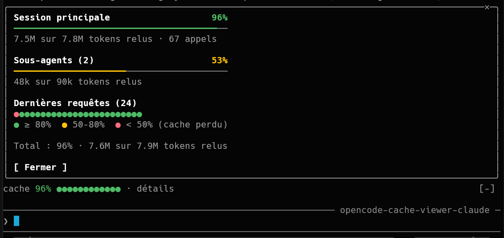

# Claude Code Cache Hit

A [Claude Code](https://claude.com/claude-code) mod that shows **how much of each request's input is read back from the prompt cache**, for the main session and its subagents.

Port of [opencode-cache-hit](https://github.com/Lucas-Rosenzweig/opencode-cache-hit) by Lucas Rosenzweig, the same idea for OpenCode.



## Why

A low cache hit rate means more quota spent and slower answers. This mod shows when the cache gets lost: a pause longer than the cache lifetime, a model, MCP or system prompt change mid-session, or subagents that start cold.

## What it shows

A clickable line above the prompt carries the overall rate and the latest requests:

```
cache 96% ●●●●●●●●●●●● · details
```

Click it (or run `/cache`) to open the popup. Click it again, press Escape or `q`, or hit **Close** to close it. Press `l` in the popup to switch between English and French.

```
Main session (67)                96%
━━━━━━━━━━━━━━━━━━━━━━━━━━━━━━━━━━━━━━──
●●●●●●●●●●●●●●●●●●●●●●●●●●●●●●●●●●●●●●●●

Subagents (2)                    65%
━━━━━━━━━━━━━━━━━━━━━━━━━━──────────────
●●●●●●●

● ≥ 80%  ● 50–80%  ● < 50% (cache lost)
Total 96% · 8.1M of 8.5M from cache
[ Close ]  [ Français ]
```

| Part | Meaning |
|---|---|
| **Main session (N)** | The conversation you type in, with its number of requests. |
| **Subagents (N)** | All subagents of the session together, with how many there are. |
| **Bar** | Share of input tokens read from the cache. |
| **Dots** | One dot per recent request, as wide as the bar. Subagent requests are put back in chronological order, even when the subagents ran in parallel. |
| **Total** | Main session and subagents together: what the session really consumed. |

Colors: green ≥ 80 %, orange 50–80 %, red < 50 %. Red also marks a lost cache: a request over 5,000 tokens with less than half of them read from the cache. The thresholds are `GOOD` and `MID` in `hooks/calc.ts`.

## Language

The interface comes in English and French. It starts in French when your locale (`LC_ALL`, `LC_MESSAGES` or `LANG`) is French, in English otherwise. Press `l` in the popup to switch; the choice is kept for the next sessions.

## Install

Requirements: a recent Claude Code with mods (hooks modules), `sh` and [`jq`](https://jqlang.org) (`apt install jq` / `brew install jq`).

In Claude Code:

```
/plugin marketplace add raphael-homann/claude-code-cache-hit
/plugin install cache-hit@claude-code-cache-hit
```

Or try it in a single session from a clone:

```bash
git clone https://github.com/raphael-homann/claude-code-cache-hit.git
claude --plugin-dir ./claude-code-cache-hit
```

## How it works

For each model response, from `message.usage` in the session transcripts:

```
cache_read_input_tokens / (input_tokens + cache_read_input_tokens + cache_creation_input_tokens)
```

- Main session: `~/.claude/projects/<project>/<session>.jsonl`. Subagents: `<session>/subagents/agent-*.jsonl`.
- Claude Code writes one transcript line per content block of a response, all with the same usage, so requests are deduplicated by `message.id`.
- `hooks/scan.sh` reads only the lines added since its last pass, so transcripts over 100 MB stay cheap. A line still being written is read on the next pass.
- Figures refresh after each tool call and at the end of each turn, at most once per second.

## Privacy and security

- Everything stays on your machine: the mod reads the session transcripts under `~/.claude/projects/` and sends nothing anywhere. It has no network access and no dependency besides `sh` and `jq`.
- The only command it runs is its own `hooks/scan.sh`, with `sh`, `jq` and coreutils (`wc`, `head`, `tail`), given an argument list (no shell string is built from data).
- Only token counts from the transcripts are drawn on screen, never their text.
- It writes one value: the chosen language, in its own store under `~/.claude/plugins/store/`.
- Windows without a POSIX `sh` is not supported.

## Development

```bash
claude plugin validate .
claude plugin test .
```

## License

MIT
